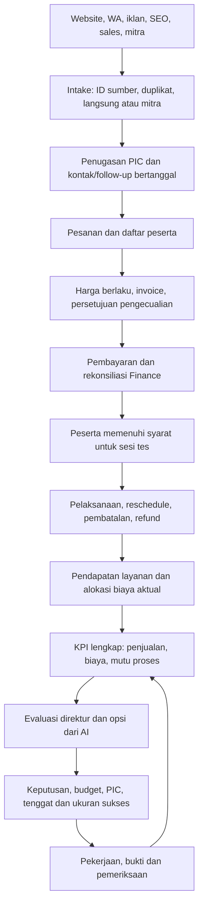

# Analisis gap fitur dan alur kerja OSEE

Tanggal: 2 Oktober 2026. Fokus: Marketing, pengukuran KPI, serta hubungannya dengan pendaftaran, Finance, operasi tes, dan Direktur.

**Kesimpulan: belum siap menjadi satu-satunya sistem untuk menjalankan dan menilai seluruh alur marketing OSEE.** Fondasi pencatatan, persetujuan KPI, bukti pekerjaan, dan audit sudah tersedia. Hubungan antarbagian, kelengkapan data, serta beberapa alur koreksi belum selesai. Audit ini menemukan satu cacat duplikasi invoice pemasok yang direproduksi dengan data sintetis; temuan lainnya dibedakan sebagai keterbatasan alur, kemampuan yang belum dibangun, atau kebutuhan penyiapan data.

Ini adalah analisis, bukan implementasi perbaikan. Tidak ada perubahan kode aplikasi, target KPI, hak akses, atau transaksi perusahaan selama audit ini.

## 1. Kondisi data yang benar-benar terlihat

Pembacaan database lokal PT Langkah Pintar Nusantara pada 2 Oktober 2026 pukul 15.08 WIB, seluruh tanggal:

| Catatan dalam ERP lokal | Jumlah |
| --- | ---: |
| Akun aktif owner/direktur | 1 |
| Akun aktif Marketing / Finance | 0 / 0 |
| Anggota tim marketing, kampanye, dan prospek | Masing-masing 0 |
| Catatan belanja iklan dan konfirmasi cakupan sumber | Masing-masing 0 |
| Target KPI, evaluasi KPI, dan bukti pekerjaan | Masing-masing 0 |
| Invoice penjualan dan mutasi bank | Masing-masing 0 |
| Tagihan pemasok | 1 |
| Paket impor sumber | 1 |
| Arsip rekap bulanan | 9: Januari–September 2026 |
| Pengecualian impor sumber | 14 |

Angka nol berarti **belum tercatat di ERP lokal**, bukan berarti perusahaan tidak memiliki penjualan atau aktivitas. Rekap historis sudah tersimpan sebagai sumber, tetapi tidak otomatis menjadi invoice, pembayaran, peserta, atau prospek operasional. Ini menjaga sistem agar tidak mengarang transaksi dari ringkasan.

Halaman Analisis yang diamati menampilkan periode 1–2 Oktober 2026, kas masuk belum terhubung, biaya iklan belum tersedia, dan respons prospek 0/0. Tampilan itu konsisten dengan keterbatasan pencatatan, bukan bukti penurunan bisnis pada Oktober.

## 2. Fondasi yang sudah tersedia

- Prospek manual, kanal, PIC, tahap penjualan, waktu respons, tenggat follow-up, serta pengaitan invoice oleh Finance/owner.
- Kampanye dan impor catatan iklan, beserta pemeriksaan cakupan sumber biaya.
- Delapan jenis KPI dengan target yang disahkan direktur; realisasi dihitung dari sumber, evaluasi disimpan, dan perubahan dasar sumber dapat ditandai.
- Pekerjaan dengan pengajuan hasil/bukti, permintaan revisi, dan pemeriksaan oleh direktur yang berbeda dari pengaju bukti.
- Riwayat perubahan dengan akun pelaku dan ekspor audit Marketing.
- Alur Finance untuk invoice, tagihan, pembayaran, uang muka, serta impor e-statement manual dengan pratinjau dan pemeriksaan duplikat.

Keberadaan fungsi ini tidak membuktikan seluruh proses bisnis sudah tersambung. Dokumentasi pengembangan sebelumnya mencatat 445 tes lulus pada PostgreSQL; seluruh suite tersebut **tidak diulang dalam audit ini**, dan hasil itu tidak mencakup kemampuan yang belum dibangun.

## 3. Temuan yang diprioritaskan

P1 = perlu ditangani sebelum mengandalkan alur terkait untuk operasi atau penilaian resmi. P2 = diperlukan untuk kerja tim dan pelaporan yang lengkap. P3 = pengembangan lanjutan setelah fondasi dan data benar. Prioritas adalah rekomendasi audit, bukan jadwal yang sudah disetujui.

### GAP-01 · P1 · Bug terkonfirmasi: invoice pemasok dapat tercatat dua kali

Entri manual menyimpan nomor dokumen pemasok dalam `supplier_reference` dan memakai nomor internal `BILL-*`. Adapter impor mencari nomor pemasok pada kolom nomor internal, kemudian membuat tagihan dengan referensi pemasok kosong. Identitas dokumen yang sama tidak bertemu.

**Bukti:** uji terisolasi menghasilkan jumlah tagihan **1 → 2** dengan pemasok, nilai, dan tanggal sama. Keduanya masih draf; tidak ada persetujuan atau pembayaran dilakukan. Ini bukan bukti bahwa data perusahaan sekarang sudah mengandung duplikasi.

**Dampak:** jika kedua draf disetujui, biaya dan utang dapat terhitung ganda. **Kriteria selesai:** entri manual dan impor memakai identitas dokumen pemasok yang sama; pengulangan impor menggunakan kembali catatan cocok atau menahan konflik untuk diperiksa; terlindung juga ketika dua permintaan datang bersamaan. Periksa duplikat lama tanpa menghapus atau menggabungkan otomatis.

Sumber: `imports/services.py:241`, `finance/services.py:419`. Reproduksi tersimpan dalam paket audit.

### GAP-02 · P1 · Penyiapan data: belum ada dasar pengukuran perusahaan

Data operasional Marketing dan invoice penjualan kosong meski arsip rekap tersedia. Akun staf juga belum disiapkan. **Dampak:** dashboard dan target belum bisa menjawab performa tim sebenarnya.

**Kriteria selesai:** daftar sumber per periode, pemilik data, rentang tanggal, jumlah baris diharapkan/diterima, duplikat, serta pengecualian disahkan. Siapkan akun pribadi, pemetaan PIC, kampanye, dan pengaitan penjualan dari dokumen yang dapat diverifikasi. Gunakan periode percobaan yang diperiksa bersama; tidak perlu mengubah seluruh arsip menjadi transaksi sekaligus.

Sumber: `run-01/evidence/local-data-counts.json` dalam paket audit.

### GAP-03 · P1 · Alur terputus: PIC prospek tidak dapat ditugaskan ulang

Prospek boleh dibuat tanpa PIC. Setelah dibuat, kolom PIC tidak tersedia dalam perintah pembaruan dan divalidasi sebagai identitas tetap. Alur untuk menetapkan PIC setelah penerimaan atau mengalihkan prospek saat staf cuti/keluar belum ada.

**Bukti perilaku:** probe data sintetis mengonfirmasi pembuatan prospek tanpa PIC berhasil, tetapi penugasan PIC yang aktif dari perusahaan sama ditolak oleh layanan pembaruan dan validasi model. Catatan tersimpan tetap tanpa PIC. Ini membuktikan batas alur sekarang; desain alih tugas berikutnya masih perlu menetapkan aturan atribusi yang adil.

**Kriteria selesai:** penugasan awal dan alih tugas dengan alasan, pemberi tugas, waktu efektif, serta riwayat penanggung jawab. Tetapkan aturan atribusi KPI sebelum/sesudah alih tugas agar skor historis tidak berubah diam-diam.

Sumber: `marketing/models.py:137,163`, `marketing/services.py:22,263`.

### GAP-04 · P1 · Akuntabilitas: identitas PIC belum terhubung ke akun login

Anggota tim hanya menyimpan nama/disiplin/tim/status aktif. Pengguna dengan izin operasional dapat mengerjakan aktivitas organisasi, tanpa hubungan akun–PIC atau delegasi terstruktur. Audit tetap mencatat pelaku yang benar; celahnya adalah pembuktian hubungan pelaku dengan tanggung jawab tugas.

**Kriteria selesai:** pemetaan anggota–akun, daftar “Pekerjaan saya”, delegasi tercatat, pengganti saat cuti, dan penonaktifan tanpa menghapus histori. Bedakan pembuat tugas, PIC, pengaju bukti, serta pemeriksa; kolaborasi yang sah tetap dimungkinkan.

Sumber: `marketing/models.py:28`, `core/models.py:25`, `marketing/activities.py:65`.

### GAP-05 · P1 · Kemampuan belum tersedia: pendaftaran → pesanan → peserta → tes

Sheet pendaftaran campuran pelanggan langsung dan mitra masih menjadi bahan pemetaan, belum menjadi model operasional yang menghubungkan peserta, pesanan, sesi tes, invoice, pembayaran, dan pelaksanaan. Prospek manual juga belum memiliki kontak terstruktur atau identitas percakapan/formulir eksternal.

**Kriteria selesai:** impor bertahap dengan pratinjau, ID sumber stabil, pemeriksaan duplikat, kontak sesuai hak akses, pemisahan pembeli dari peserta, serta konfirmasi mitra. Satu pesanan mitra dapat memiliki banyak peserta; peserta yang namanya berbeda tidak otomatis menjadi pelanggan/pembayar baru. Pendaftaran tidak otomatis membuktikan pembayaran atau pendapatan.

Sumber: `docs/REGISTRATION-DATA-MAPPING.md`, `core/modules.py:16`, `imports/services.py:298`, `marketing/models.py:131`.

### GAP-06 · P1 · Kontrol belum lengkap: pengesahan KPI tidak mengesahkan kelengkapan bisnis

KPI nonbiaya dapat memperoleh status evaluasi resmi setelah target aktif, periode berakhir, dan skor dapat dihitung. Itu belum mewajibkan bukti bahwa semua prospek/pendaftaran dan pembayaran periode sudah tercatat. Sebagai contoh konseptual, respons 100% atas satu prospek tercatat tidak membuktikan semua pesan masuk perusahaan telah ditangani. Catatan batasan sekarang sudah ditampilkan; masalahnya bukan kesalahan rumus.

**Kriteria selesai:** status terpisah “sementara”, “sumber belum lengkap”, dan “periode telah diperiksa”; pemeriksaan cakupan semua sumber yang relevan sebelum pengesahan bisnis. Biaya yang sudah memiliki kontrol cakupan tetap dipertahankan. Perubahan sumber setelah penutupan harus membuka kebutuhan evaluasi ulang.

Sumber: `marketing/kpi.py:268`, `marketing/kpi_models.py`, `docs/MARKETING-KPI-AND-AUDIT.md`.

### GAP-07 · P1 · Dua jalur penyelesaian pekerjaan

Saran Manager membuat `MarketingAction`, yang dapat ditutup dengan teks hasil. “Bukti Pekerjaan” memakai `WorkActivity`, yang memerlukan pemeriksaan independen. Tidak ada relasi antara keduanya. “Selesai” pada satu layar belum bermakna “bukti diterima” pada layar lain.

**Kriteria selesai:** saran → penugasan → bukti → pemeriksaan memakai satu alur atau relasi yang eksplisit; tindakan lama tetap terlacak. Tampilkan terpisah pelaksanaan selesai, bukti diterima, dan hasil KPI tercapai. Ketiganya bukan kejadian yang sama.

Sumber: `marketing/views.py:450`, `marketing/services.py:325`, `marketing/activities.py:19`.

### GAP-08 · P1 · Kontrol Finance: mutasi lengkap belum dapat dibuktikan

Impor/duplikat/pencocokan baris yang tersedia tidak memastikan seluruh e-statement telah masuk. Saldo berjalan digunakan untuk identitas baris, tetapi belum divalidasi kesinambungannya terhadap saldo awal, arus masuk/keluar, dan saldo akhir yang diverifikasi. Baris yang hilang bisa tidak terlihat oleh pemeriksaan penutupan.

**Kriteria selesai:** rekonsiliasi saldo dan cakupan rekening/periode, deteksi periode tumpang tindih/terlewat, daftar selisih, serta pengesahan Finance sebelum kas periode menjadi dasar evaluasi. Ini dapat dibangun pada impor Excel/CSV tanpa menunggu API BNI.

Sumber: `webapp/statement_import.py:225`, `finance/services.py:543`.

### GAP-09 · P1 · Kemampuan operasional: penyelesaian layanan masih satu invoice penuh

Invoice mewakili satu produk/kuantitas/tanggal; konfirmasi layanan melepaskan pendapatan ditangguhkan untuk invoice secara keseluruhan. Belum ada alur peserta yang mengikuti tes pada tanggal berbeda, pemenuhan sebagian, pembatalan sebagian, atau koreksi/credit note setelah layanan diberikan. Ini penting untuk pesanan grup dari mitra.

**Kriteria selesai:** rincian pesanan/invoice dan pemenuhan per peserta atau unit layanan; pindah jadwal mempertahankan riwayat; pembatalan/refund/koreksi disetujui dan terhubung ke catatan asal. Finance mengakui pendapatan sesuai layanan yang benar-benar diberikan. Detail kebijakan akuntansi perlu ditetapkan dalam fase implementasi, bukan diasumsikan oleh marketing.

Sumber: `finance/models.py:197`, `finance/services.py:250,845,913`.

### GAP-10 · P2 · Laba dan KPI mitra belum terukur lengkap

KPI sekarang berpusat pada prospek, kas bruto, respons, dan belanja. Prospek dengan pembayaran termasuk pembayaran sebagian. Satu prospek–satu invoice membantu mencegah atribusi ganda, tetapi belum mencakup akun mitra dengan pesanan berulang, pembagian invoice, atau koreksi salah tautan. Kas bruto tidak dikurangi refund menjadi ukuran hasil bersih.

Harga jual sudah memiliki versi, tetapi estimasi biaya belum menjadi alokasi tagihan IIEF aktual ke pesanan/sesi. Angka kontribusi direktur masih dapat berbasis asumsi skenario. Perubahan harga jual dengan alasan juga belum memiliki persetujuan terpisah atau batas margin minimum.

**Kriteria selesai:** pisahkan invoice dibayar sebagian/lunas, pesanan/peserta/mitra, penjualan bruto/neto, refund, dan pendapatan layanan. Alokasikan biaya IIEF yang berlaku ke unit layanan; tampilkan margin aktual hanya ketika biaya lengkap. Buat koreksi atribusi yang diaudit, kebijakan diskon/override, dan indikator mitra pertama kali/berulang/reaktivasi. Pisahkan ITP, iBT, kursus, langsung, dan mitra.

Sumber: `marketing/analytics.py:126,139,315`, `marketing/services.py:285`, `finance/services.py:143,194`, `director/calculators.py:80`.

### GAP-11 · P2 · Pekerjaan harian dan follow-up belum membentuk antrean lengkap

Ada tanggal follow-up dan filter terlambat, tetapi belum ada linimasa setiap kontak, hasil komunikasi, alasan kalah terstruktur, tenggat jam kerja, pengingat, atau antrean pemeriksa yang menua. Catatan teks yang ditimpa menyulitkan handoff meski perubahan mentah tersimpan dalam audit. Koreksi waktu respons belum meminta alasan khusus. Aturan saran AI respons memakai ambang 60 menit, belum membaca SLA yang disahkan perusahaan.

**Kriteria selesai:** satu layar “Hari ini”: belum ditugaskan, belum direspons, janji follow-up hari ini, lewat tenggat, hasil perlu revisi, dan bukti menunggu direktur. Kontak bertanggal dengan pelaku, kanal, hasil, bukti, dan janji berikutnya. SLA mengikuti kebijakan yang disahkan, termasuk kalender kerja dan aturan koreksi. Pengingat tidak berulang tanpa alasan dan memiliki jalur eskalasi.

Sumber: `marketing/views.py:193`, `marketing/models.py:143`, `marketing/performance_views.py:156`, `marketing/ai.py:95`.

### GAP-12 · P2 · Siklus kampanye belum dapat ditutup

Status aktif/jeda/selesai tersedia pada model, tetapi jalur aplikasi hanya membuat/menampilkan kampanye. Belum ada pause/resume/complete, alih pengelola, atau tanggal akhir aktual yang terpisah dari rencana.

**Kriteria selesai:** perubahan status berversi dengan alasan, tanggal efektif, penanggung jawab, batas periode belanja, dan pengesahan hasil akhir. Data kampanye lama tetap dapat ditelusuri.

Sumber: `marketing/models.py:50,61`, `marketing/urls.py:19`, `marketing/services.py:156`.

### GAP-13 · P1 untuk tujuan direktur · Dashboard dan AI belum memakai KPI/pekerjaan baru

Snapshot Direktur masih menandai atribusi marketing sebagai belum tersedia; saldo bank terverifikasi belum tersedia dalam snapshot. AI Direktur memakai observasi marketing lama, sedangkan AI Marketing memakai analisis lama dan mengurutkan rekomendasi yang sudah ditentukan. Target/evaluasi KPI dan bukti pekerjaan baru belum menjadi masukan AI. Tautan navigasi sudah ada, tetapi bukan integrasi data.

**Kriteria selesai:** Direktur dan AI membaca layanan fakta KPI/Finance yang sama: target, aktual, selisih, versi sumber, umur evaluasi, kelengkapan data, pekerjaan menunggu pemeriksaan, biaya, dan batas kepastian. Hubungkan keputusan → PIC → budget → pekerjaan → ukuran keberhasilan → tanggal evaluasi. AI boleh menyusun opsi dan alasan bersumber; pengesahan target, pengeluaran, atau perubahan data tetap memakai alur berizin.

Sumber: `director/analytics.py:54,180,205`, `director/ai.py:179,421`, `marketing/ai.py:163`, `director/services.py:229`.

### GAP-14 · P2 · Koreksi dan bukti belum lengkap siklusnya

Pengecualian impor bersifat tetap dengan status terbuka; sumber bulanan revisi yang tumpang tindih ditolak tanpa alur pengganti. Bukti aktivitas berupa teks/referensi, belum berupa lampiran privat berversi. Pekerjaan yang diterima menjadi tetap, tetapi belum ada koreksi yang menunjuk versi sebelumnya.

**Kriteria selesai:** kotak pengecualian dengan PIC, keputusan, dokumen pendukung, dan jejak penyelesaian; versi sumber pengganti tanpa menimpa histori; bukti dengan akses terbatas, identitas versi, dan hubungan koreksi. Laporan terkait ditandai perlu evaluasi ulang jika koreksi mengubah dasarnya.

Sumber: `imports/models.py:86`, `imports/services.py:276`, `marketing/activity_models.py:33,65`.

### GAP-15 · P3 · Workflow spesifik kanal dan sinkronisasi

Konten, SEO, iklan, mitra, dan sales masih sebagian besar berupa aktivitas generik. Belum ada siklus lengkap brief → persetujuan → publikasi → hasil; portfolio halaman/query SEO; onboarding → pesanan pertama → repeat order mitra; atau sinkronisasi sumber pendaftaran, iklan, dan percakapan. API BNI menunggu proses bank berdasarkan keterangan pengguna; kesiapan konektor eksternal tidak diverifikasi pada audit ini.

**Kriteria selesai:** mulai dari impor terkontrol dan ID sumber yang benar, kemudian konektor dengan pengulangan aman, pencatatan waktu sinkronisasi, konflik, kegagalan, serta penanggung jawab pemulihan. Hubungkan fitur kanal ke tugas/KPI yang sama, tidak membuat dashboard terpisah lagi. Rancang kontrak antar-modul agar Operations kelak mengirim status pemenuhan tanpa memberi Marketing akses jurnal keuangan.

Sumber: `marketing/activity_models.py:20`, `core/modules.py:21`, `core/models.py:62`, `webapp/statement_views.py:82`.

## 4. Alur kerja tujuan

Ini rancangan tujuan, bukan deskripsi bahwa semua langkah sudah tersedia. Untuk mitra yang membayar sebelum tes, status lunas dan kelayakan peserta perlu diperiksa sebelum pelaksanaan. Pengecualian kebijakan harus eksplisit dan disetujui, bukan diubah melalui catatan bebas.

## 5. KPI seimbang yang disarankan

Nilai target dan bobot tidak ditetapkan dalam audit. Tetapkan dari baseline yang sudah lengkap dan pekerjaan masing-masing PIC. Jangan memberikan satu skor identik kepada sales, SEO, dan pengelola iklan, atau menjadikan jumlah pekerjaan sebagai bukti keberhasilan bisnis.

| Dimensi | Ukuran yang disarankan | Sumber dan batasan |
| --- | --- | --- |
| Hasil penjualan | Pesanan lunas, peserta berbayar, pendapatan layanan neto | Pesanan–invoice–pembayaran–pemenuhan–koreksi; hitung masing-masing unit secara terpisah |
| Mitra | Mitra aktif berbayar, mitra baru dengan pesanan pertama, repeat order, reaktivasi | Identitas akun mitra dan histori pesanan; definisi aktif/berulang serta jendela waktunya disahkan |
| Biaya | Realisasi terhadap budget, biaya per pesanan/pelanggan baru, margin kontribusi | Biaya iklan terverifikasi dan biaya layanan teralokasi; hindari menghitung peserta mitra sebagai pelanggan baru langsung |
| Disiplin respons | Proporsi respons dalam SLA dan antrean belum direspons | Semua prospek periode, waktu diterima/respons, kalender kerja; median saja dapat menyembunyikan ekor yang lambat |
| Disiplin follow-up | Janji follow-up yang dipenuhi tepat waktu / seluruh janji jatuh tempo | Event kontak dan hasil, bukan hanya tanggal next-follow-up saat ini |
| Mutu pekerjaan | Bukti diterima, revisi, keterlambatan pengajuan dan pemeriksaan | Tanggal pelaksanaan, pengajuan, pemeriksa; diterima tidak otomatis berarti menghasilkan penjualan |
| Mutu data | Cakupan sumber, catatan belum terhubung, duplikat, umur pengecualian | Rekonsiliasi sumber per periode; hasil belum lengkap tidak boleh diberi skor seolah lengkap |

Rasio kas bruto/belanja iklan yang sekarang tersedia boleh dipertahankan dengan label yang jelas. Jangan menyebutnya laba atau efek sebab-akibat iklan. Pembayaran sebagian, uang muka yang belum diterapkan, refund, dan layanan yang belum diberikan memerlukan ukuran terpisah.

## 6. Urutan pengerjaan yang disarankan

1. **Lindungi data dan biaya:** perbaiki identitas tagihan impor; bangun penutupan pengecualian serta rekonsiliasi kelengkapan bank/sumber.
2. **Buat tim dapat bekerja:** akun–PIC, penugasan/alih tugas, kontak, antrean hari ini, riwayat follow-up, satu alur pekerjaan dan bukti.
3. **Sambungkan penjualan OSEE:** intake pendaftaran, pelanggan langsung/mitra/peserta/pesanan, invoice/pembayaran, sesi dan pemenuhan sebagian. Dahulukan satu alur ITP mitra dan satu alur pelanggan langsung yang dapat diuji dari awal sampai akhir.
4. **Buat hasil dapat dipercaya:** biaya IIEF aktual, margin, refund-neto, repeat order, kelengkapan periode, dan paket evaluasi KPI. Pengisian angka target dilakukan setelah baseline diperiksa.
5. **Tutup siklus manajemen:** satukan fakta di Direktur dan AI, relasikan keputusan/budget/pekerjaan/evaluasi; kemudian tambah konten, SEO, dan konektor eksternal.

Urutan ini tidak menunggu persetujuan API BNI untuk memperbaiki pencatatan. Impor CSV/Excel yang lengkap dan terkontrol dapat menjadi jalur pertama.

## 7. Skenario penerimaan untuk fase implementasi

- Dokumen pemasok yang sama masuk manual lalu impor: hanya satu tagihan bisnis; dokumen bertentangan masuk antrean pemeriksaan.
- Lead masuk tanpa PIC, kemudian ditugaskan dan dialihkan: histori dan perhitungan tanggung jawab dapat dijelaskan.
- Satu mitra membeli untuk beberapa peserta dan tanggal tes: pembayaran, kelayakan, layanan yang sudah diberikan, penjadwalan ulang, serta biaya tidak tercampur.
- Pembayaran sebagian lalu pelunasan/refund: ukuran dibayar sebagian, lunas, kas bruto/neto, dan pendapatan layanan tidak saling menggantikan.
- Satu baris mutasi atau satu sumber lead sengaja tidak dimasukkan: periode ditandai belum lengkap, bukan otomatis disahkan.
- Saran direktur menjadi pekerjaan: bukti diperiksa pihak berbeda dan evaluasi hasil menunjuk KPI serta budget terkait.
- Data sumber dikoreksi setelah evaluasi: versi lama tetap tersedia dan keputusan lama ditandai menggunakan dasar yang sudah berubah.
- Akun Marketing, Finance, dan Owner menjalankan bagiannya tanpa berbagi kredensial; batas akses dan delegasi diuji.

## 8. Bukti dan batas audit

Kode yang dibaca: commit `e5d55b2c36b7c187a7eed3549816a4fd5452056d` ditambah perubahan lokal fitur Marketing. Sidik isi sumber: `83f600a41651b155c13c7f48d3fb45b43dbbf0131bad763368f4106e4b1d6f5d`. Commit saja tidak mewakili semua perubahan lokal tersebut.

Paket bukti lokal: `D:\ERP osee\.local\marketing-gap-analysis-2026-10-02\`. Mencakup inventaris sumber, hitungan data agregat tanpa isi dokumen/kontak, observasi halaman lokal, probe sintetis, dan hasil pemeriksaan paket audit.

Audit membedakan pemeriksaan sumber, observasi UI, dan reproduksi terisolasi. Tidak menjalankan pengeluaran, persetujuan tagihan nyata, pengiriman pesan, konektor berbayar, atau perubahan data perusahaan. Tidak membuktikan identitas deployment cloud, keamanan produksi lengkap, ketepatan pajak, kesiapan API bank/iklan, performa skala besar, atau pemulihan backup. Hal-hal tersebut memerlukan pemeriksaan tersendiri.

Tindak lanjut berikutnya adalah perbaikan GAP-01 dan penyusunan alur penugasan/data sebelum perluasan dashboard. Laporan ini tidak menandai perbaikan sebagai selesai.
