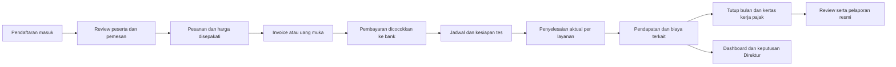

# Audit alur kerja dan kemampuan OSEE ERP — 25 September 2026

## Kesimpulan penggunaan

Fondasi aplikasi sudah mendukung sejumlah alur Finance secara terkontrol, tetapi **belum layak menjadi satu-satunya sistem pembukuan, pelaporan pajak, dan pengambilan keputusan perusahaan**. Pilot dengan data terverifikasi dan pendampingan masih merupakan tujuan yang tepat. Ada cacat yang berhasil direproduksi, alur pengecualian yang belum lengkap, dan hubungan antarmodul yang belum terbentuk.

Prioritas terdekat: benarkan tanggal pendapatan, cegah tagihan pemasok ganda, samakan saldo tertagih Finance–Marketing, sediakan koreksi pajak, dan satukan validasi unggahan. Setelah itu, hubungkan peserta → pesanan → pembayaran → pelaksanaan → biaya → laporan. AI baru dapat memberi arahan yang lebih berguna setelah dasar angka tersebut konsisten.

Audit ini meninjau commit `b4dd9cd1ee6e93406913624322848ce6c3985101`, kode, formulir, laporan, hak akses, dan pengujian sintetis. Tidak ada perbaikan kode produk, perubahan data perusahaan, impor peserta, pengiriman pesan pelanggan, panggilan provider AI, atau publikasi cloud yang dilakukan. Laporan ini bukan pemeriksaan ulang peraturan pajak atau sertifikasi keamanan.

## Bukti pemeriksaan

| Pemeriksaan pada 25 September | Hasil dan batas |
| --- | --- |
| Suite aplikasi SQLite | 346 tes ditemukan: **343 lulus, 3 dilewati**, tanpa kegagalan. Tiga tes yang dilewati memerlukan penguncian PostgreSQL. |
| Browser terisolasi | **148 pemeriksaan halaman**, Owner/Finance/Marketing, lebar 1440 dan 390; tidak ada HTTP gagal, overflow seluruh halaman, atau error JavaScript. |
| Alur browser | **10 alur lulus**: impor/pratinjau/konfirmasi mutasi, saldo awal, biaya bank, transfer internal, uang muka, alokasi, refund uang muka, pembatalan, refund pesanan, pelepasan biaya dibayar di muka. |
| Pemeriksaan tambahan | `pip check`, Django system check, kesesuaian migrasi, dan lint kategori kesalahan Python kritis lulus; **5 tes backup lulus**. Cakupan kode dalam persen tidak diukur. |
| Regresi Finance baru | **3 dari 3 gagal memenuhi perilaku yang diperlukan**: tanggal penyelesaian, pengulangan tagihan pemasok, dan PDF pembatalan. Kegagalan ini adalah temuan audit, belum diperbaiki. |
| Probe Marketing/Direktur | 5 probe: 4 gagal terhadap ekspektasi bisnis; 1 membuktikan hubungan data Marketing ke AI Direktur belum tersedia. Dua kegagalan berasal dari dua variasi masalah penagihan yang sama. |
| Probe pajak | 3 probe observasi lulus: kontrol persetujuan tahunan normal, reproduksi draft duplikat yang memblokir persetujuan, dan ketidaksamaan validasi PDF. “Lulus” di sini berarti kondisi temuan berhasil direproduksi, bukan cacat sudah diperbaiki. |
| CI GitHub yang sudah ada | [Run pada commit yang sama](https://github.com/leonardusbayu/osee-erp/actions/runs/35316919906) berhasil pada 18 September; mencakup PostgreSQL dan pemeriksaan container/backup/transfer. Itu bukti historis, bukan pengujian cloud perusahaan pada 25 September. |

Data nyata diperiksa hanya-baca. Organisasi perusahaan lokal masih memiliki 0 invoice pelanggan, 0 rekening bank, 0 mutasi, 0 jurnal, 0 versi harga, 0 prospek Marketing, 0 budget Direktur, 0 kewajiban pajak, dan 1 tagihan pemasok. Ada 1 membership perusahaan. OpenRouter Finance/Direktur belum dikonfigurasi pada instalasi yang diperiksa. Konfigurasi lokal masih mode pengembangan, dengan MFA tidak diwajibkan. Endpoint lokal port 8000 tidak dapat dijangkau saat pemeriksaan; QA browser memakai server sementara tersendiri yang berhenti setelah pengujian.

Salinan registrasi yang dianalisis pada **21 September** berisi 2.643 baris mentah, termasuk 2.199 tanggal tes tahun 2026. Itu bukan jumlah peserta unik atau kas/pendapatan. Lihat [pemetaan pendaftaran](REGISTRATION-DATA-MAPPING.md). Sheet tidak diambil ulang untuk audit ini.

## Temuan yang harus ditangani sebelum pemakaian rutin

P1 berarti berpotensi merusak ketepatan pencatatan, tindakan staf, atau kontrol dokumen; selesaikan sebelum bergantung pada alur terkait. P2 berarti perlu diperbaiki untuk kelengkapan dan keandalan operasional. Nomor di bawah adalah ID temuan, bukan urutan pembangunan seluruh ERP.

### QA-01 · P1 · Tanggal pendapatan mengikuti hari pencatatan

**Bukti:** [webapp/views.py:291](../webapp/views.py#L291) selalu mengirim tanggal hari ini ke layanan penyelesaian. Layanan domain sebenarnya mendukung tanggal aktual.

**Reproduksi:** tes dibayar sebelum pelaksanaan dan selesai 31 Agustus; Finance mencatat pada 25 September. Sistem menyimpan penyelesaian 25 September, sekalipun tanggal 31 Agustus dikirim melalui POST. Akibatnya pendapatan masuk bulan yang berbeda. Probe tanggal gagal sebagaimana diperkirakan.

**Perbaikan:** form konfirmasi meminta tanggal selesai aktual dan referensi bukti. Tanggal rencana tetap terpisah. Pertahankan pemeriksaan pembayaran sebelum layanan, periode tertutup, idempotensi, serta larangan tanggal aktual masa depan. **Penerimaan:** input terlambat pada bulan terbuka masuk ke bulan layanan; periode tertutup masuk antrean koreksi, bukan diam-diam memakai hari ini.

### QA-02 · P1 · Tagihan pemasok yang sama dapat dibukukan dua kali

**Bukti:** [BillForm](../webapp/forms.py#L89) tidak meminta nomor invoice asli pemasok; [bill_create](../webapp/views.py#L324) membuat nomor internal baru setiap kali. Keunikan supplier+number tidak mengenali dokumen yang sama.

**Reproduksi:** kirim data tagihan sumber yang sama dua kali. Tercipta dua tagihan dengan nomor internal berbeda; keduanya dapat disahkan. Probe menghasilkan dua utang, bukan satu.

**Perbaikan:** pisahkan nomor internal dan nomor dokumen pemasok. Gunakan validasi unik yang sesuai organisasi/pemasok, peringatan kemiripan nominal/tanggal/hash, serta token pengiriman ulang. Dokumen yang memang tidak memiliki nomor perlu jalur pengecualian eksplisit. **Penerimaan:** pengulangan submit tidak menggandakan beban/utang; dokumen berbeda dengan nilai sama tetap dapat dicatat setelah diperiksa.

### QA-03 · P1 · Marketing menagih invoice yang sudah tidak tertagih

**Bukti:** [marketing/analytics.py:175](../marketing/analytics.py#L175) dan [marketing/views.py:195](../marketing/views.py#L195) menghitung pembayaran dari alokasi mutasi biasa, tanpa seluruh aturan uang muka dan pembatalan di Finance.

**Reproduksi:** baik invoice lunas melalui uang muka maupun invoice dibatalkan memiliki saldo tertagih Finance Rp0. Marketing masih menunjukkan Rp100 tertagih pada fixture, memasukkannya ke daftar terlambat, serta menyarankan penagihan. Keduanya diuji melalui perhitungan dan halaman HTTP.

**Perbaikan:** sediakan satu perhitungan status finansial yang dipakai Finance, Marketing, Direktur, dan AI. Pisahkan saldo tertagih, penerimaan bruto, uang muka belum terpakai, refund terutang, dan kas bersih. **Penerimaan:** invoice lunas/dibatalkan tidak menjadi target penagihan; kasus sebagian bayar dan batas tanggal historis tetap benar.

### QA-04 · P1 · Salah membuat draft pajak dapat mengunci persetujuan tahunan

**Bukti:** [taxes/workflow.py:359](../taxes/workflow.py#L359) menahan persetujuan bila ada kewajiban yang belum disetujui; [taxes/models.py:247](../taxes/models.py#L247) melarang penghapusan, tanpa alur void/supersession di UI.

**Reproduksi:** profil dan 12 periode sintetis yang memenuhi prasyarat dapat memperoleh persetujuan tahunan pada kasus kontrol. Menambahkan satu draft kewajiban duplikat diterima, tetapi draft tidak dapat dihapus dan persetujuan tahunan terblokir. Menganggap draft salah tersebut benar bukan penyelesaian yang dapat diterima.

**Perbaikan:** pembatalan draft dengan alasan dan audit; revisi yang menunjuk versi sebelumnya untuk keputusan yang sudah disetujui; pembaruan snapshot tahunan dan koreksi pembukuan jika relevan. **Penerimaan:** draft salah dapat diselesaikan tanpa menghilangkan riwayat atau menyetujui angka palsu; versi yang diganti tidak masuk total aktif.

### QA-05 · P1 · Proteksi unggahan PDF tidak konsisten

**Bukti:** [taxes/workflow.py:82](../taxes/workflow.py#L82) memeriksa format/enkripsi/jumlah halaman, tetapi tidak memakai pemeriksaan konten aktif pada [evidence/services.py:34](../evidence/services.py#L34).

**Reproduksi:** PDF sintetis dengan JavaScript inert ditolak oleh validator lampiran utama, tetapi diterima dan disimpan utuh oleh jalur bukti pajak. Tidak ada eksploitasi pembaca PDF yang dilakukan; risiko bergantung pada aplikasi yang membuka dokumen.

**Perbaikan:** satu validator dokumen untuk seluruh jalur bukti, ditambah kebijakan unduhan privat yang sudah ada. **Penerimaan:** file yang ditolak pada satu jalur juga ditolak pada jalur lain; PDF biasa tetap diterima.

### QA-06 · P2 · PDF invoice dibatalkan masih menunjukkan sisa tagihan

[webapp/documents.py:152](../webapp/documents.py#L152) menghitung total dikurangi pembayaran, sementara model Finance mengembalikan saldo tertagih nol untuk pembatalan. Probe invoice Rp500.000 tanpa pembayaran yang dibatalkan menghasilkan PDF berlabel dibatalkan tetapi masih menampilkan sisa Rp500.000.

**Perbaikan/penerimaan:** PDF memakai status finansial yang sama dengan layar dan ledger; nilai historis, piutang aktif, serta kewajiban refund diberi label terpisah. Uji pembatalan tanpa pembayaran dan dengan pembayaran sebagian.

### QA-07 · P2 · Mencatat pembayaran lewat penggantian budget dapat mengembalikan plafon

[director/services.py:334](../director/services.py#L334) menghapus pengaruh entri lama lewat void sebelum membuat pengganti. Form mengizinkan perubahan jenis entri. Probe budget Rp100 dengan biaya terjadi Rp60 yang diganti menjadi pembayaran Rp60 menghasilkan anggaran tersedia Rp100, bukan Rp40.

Ini **kelemahan alur/kontrol**, bukan pembobolan otorisasi: koreksi entri salah memang dapat memerlukan void. Namun pembayaran atas biaya yang sudah terjadi harus menjadi catatan terkait, bukan mengganti dan menghilangkan biaya tersebut.

**Perbaikan/penerimaan:** tindakan terpisah “Catat pembayaran”, “Realisasikan komitmen”, dan “Koreksi entri”. Pembayaran tidak mengembalikan anggaran terpakai; realisasi sebagian menyisakan komitmen yang benar. Tambahkan kembalikan untuk revisi/tolak/amend pada siklus budget yang sekarang hanya draft → diajukan → disetujui.

### QA-08 · P2 · Kelengkapan biaya iklan belum membuktikan cakupan periode

[marketing/analytics.py:129](../marketing/analytics.py#L129) menilai nilai yang ada pada baris unggahan, tanpa bukti semua hari/periode tercakup. Probe periode 1–25 September dengan satu baris biaya Rp10 dan penerimaan Rp100 menghasilkan `spend_complete=True` serta rasio 10×. Perhitungan dari data yang masuk benar, tetapi cakupan penyebut belum dibuktikan.

**Perbaikan/penerimaan:** bedakan “nilai baris terisi” dan “periode sumber lengkap”. Simpan cakupan sumber serta konfirmasi hari tanpa aktivitas. Rasio boleh menjadi hasil parsial berlabel, tetapi rekomendasi peningkatan budget memerlukan cakupan yang sebanding dan matang. Rasio penerimaan/biaya ini juga bukan bukti sebab-akibat iklan atau laba.

## Kemampuan saat ini dan pekerjaan yang masih dibutuhkan

| Alur | Yang tersedia | Batas yang berdampak pada OSEE |
| --- | --- | --- |
| Invoice dan harga mitra | Harga efektif, snapshot harga, invoice, alokasi, uang muka dan pembatalan penuh sebelum layanan | Satu produk per invoice; belum ada pesanan multi-komponen, roster, penyelesaian sebagian, atau reschedule terkontrol. |
| Bank | Impor Excel/CSV, pemetaan, pratinjau, konfirmasi atomik, deteksi pengulangan, arsip sumber privat | Statement BNI asli belum diuji; sinkronisasi API dan pengiriman transfer tidak aktif. |
| Koreksi Finance | Jurnal/alokasi terposting dilindungi | Belum ada reversal/reallocation umum. Salah cocok invoice atau menambah alokasi pada pasangan yang sama memerlukan alur koreksi resmi. |
| Tutup bulan | Penghalang penutupan, laporan ledger, periode terkunci | Pesanan terlambat yang dipindah jadwal tidak memiliki alur reschedule. Menunggu tes selesai mempertahankan pembayaran tetapi menahan close; pembatalan/recreate tidak otomatis memindahkan pembayaran. |
| Biaya IIEF dan margin | Tagihan pemasok memengaruhi beban atau biaya dibayar di muka; simulasi harga tersedia | Belum ada alokasi biaya tagihan ke sesi/pesanan/mitra. Margin per mitra aktual belum dapat dibuktikan; simulasi masih memakai asumsi. |
| Pendaftaran | Sumber sheet telah dianalisis; rekap 2026 diarsipkan sebagai observasi | Belum ada modul peserta/sesi/pesanan atau importer registrasi. Nama mitra/pemesan per baris belum diketahui. |
| Pajak bulanan/tahunan | Review terdokumentasi, mesin hitung, bukti privat, kertas kerja dan versi tahunan | Masih membutuhkan klasifikasi, fakta perusahaan, dan review. Belum merupakan pengiriman SPT otomatis atau bukti acceptance DJP. Koreksi dan dokumen yang mencakup beberapa kewajiban perlu didukung. |
| Marketing | Prospek, kampanye, data iklan manual/impor, tindak lanjut, analisis dimensi dan saran | Hubungan satu lead–satu invoice belum mewakili seluruh pembelian ulang mitra. Penerimaan bruto berlabel tersedia; net cash/refund dan uang muka belum masuk seluruh metrik. Konektor kanal belum aktif. |
| Direktur | Sasaran, keputusan, anggaran, simulasi harga, rencana kas 13 minggu, sumber rekap | Saldo kas terverifikasi masih hardcoded tidak tersedia; rencana kas memakai asumsi. Memasukkan lebih banyak mutasi saja belum mengaktifkan fitur saldo tersebut. |
| AI Direktur | Fakta/opsi terbatas, sumber, batas biaya dan kebijakan data | [director/ai.py:190](../director/ai.py#L190) membaca tabel Marketing lama. Probe belanja pada `AdDailyObservation` tidak masuk fakta belanja AI Direktur. Ini integrasi yang belum ada, bukan angka yang dipalsukan. |
| AI pajak | Sumber yang dipublikasikan melalui review, pemeriksaan kesegaran, jawaban ditandai perlu review | Citation ID yang sah tidak menjamin isi jawaban benar. UI juga belum menampilkan flag sumber historis/tidak berlaku dari backend ketika jawaban lama dibuka kembali. |
| SDM/payroll/akademik/portal mitra | Sudah dicatat sebagai rencana modul | Belum aktif; SDM/payroll tetap direncanakan di bawah Finance. |
| Cloud dan pemulihan | Artefak deployment, MFA, backup/restore dan CI tersedia | Domain/HTTPS perusahaan, operasi server, backup di luar host dan latihan pemulihan tim belum diterima sebagai layanan nyata. GitHub bukan hosting aplikasi. |

Keterbatasan dokumen pajak gabungan perlu diperbaiki sebelum otomatisasi menyeluruh: referensi bukti unik dan pencocokan nominal saat ini terikat ke satu kewajiban. Buat objek pembayaran/pelaporan gabungan dan alokasi yang jumlahnya tidak melebihi bukti; jangan memaksa pengunggahan bukti yang sama sebagai transaksi baru.

## Alur sasaran yang lebih sederhana

Diagram menggambarkan alur utama pesanan prabayar. Koreksi, perpindahan jadwal, pembayaran gabungan dan refund harus menjadi cabang resmi dengan riwayat, bukan diatasi dengan edit database atau tanggal pengganti.

1. **Pisahkan peserta, pemesan, dan pembayar.** Satu mitra dapat membeli untuk banyak peserta; kontak mitra bukan identitas unik peserta. Tentukan ID peserta, ID pendaftaran, ID pesanan, pembeli dan baris layanan. Bukti transfer tidak otomatis berarti pendaftaran lunas.
2. **Jadikan pesanan penghubung utama.** Pesanan menyimpan komponen ITP/preparation/kursus, kuantitas, harga yang disetujui dan riwayat perubahan. Invoice tetap dokumen penagihan; sesi menjadi bukti pelaksanaan. Penyelesaian satu peserta tidak mengakui pendapatan seluruh paket.
3. **Kelola harga dan biaya historis.** Bedakan harga jual kontrak mitra, biaya IIEF yang diperkirakan, tagihan pemasok aktual, serta alokasi biayanya. Biaya lama tidak berubah saat tarif IIEF naik. Jumlah biaya dialokasikan + belum dialokasikan harus sama dengan sumbernya.
4. **Sediakan alur pengecualian.** Pindah jadwal mempertahankan pembayaran dan pendapatan ditangguhkan; koreksi pembayaran memakai reversal dan pengganti; refund memiliki status persetujuan, utang refund dan bukti keluar. Catatan salah dapat diperbaiki dengan jejak audit.
5. **Satu definisi angka untuk semua modul.** Status tertagih, penerimaan bruto, pengembalian, pendapatan, margin dan kelengkapan periode disediakan bersama. Seluruh dashboard dan AI mengambil snapshot terotorisasi yang sama, dengan tanggal batas dan tautan bukti.
6. **Pertahankan struktur Django dengan modul yang jelas.** Letakkan perubahan di modul domain, bukan menyalin rumus pembayaran ke setiap halaman. Gunakan transaksi atomik/idempotensi yang sudah ada. Tambahkan antrean retry dan pencatatan event untuk konektor ketika integrasi nyata mulai berjalan.

## Pengalaman pengguna dan pembagian kerja

Hasil browser menunjukkan navigasi dan layout dasar berfungsi. Peninjauan visual juga menunjukkan halaman pajak cukup panjang di ponsel dan tabel membutuhkan geser horizontal. Itu bukan kegagalan layout seluruh halaman, tetapi bisa memperlambat Finance yang belum memahami istilah pajak.

| Tim | Halaman awal yang disarankan | Keputusan/tugas utama |
| --- | --- | --- |
| Finance | “Pekerjaan hari ini”: mutasi belum cocok, pembayaran belum jelas, tagihan mirip, layanan perlu bukti selesai, tugas penutupan/pajak | Konfirmasi data dan bukti; sistem menghitung deterministik. Tindakan menjelaskan dampak sebelum disimpan. |
| Marketing | Prospek perlu ditindaklanjuti, pesanan belum konversi, biaya iklan belum lengkap, eksperimen aktif | Dapat melihat status pembayaran yang diperlukan tanpa akses mutasi rinci/KTP/dokumen pajak. Jangan menagih berdasarkan label yang berbeda dari Finance. |
| Owner/Direktur | Keputusan yang menunggu, pertumbuhan pada periode sebanding, kas yang telah direkonsiliasi, kewajiban layanan, budget dan risikonya | Menyetujui pengecualian/harga/budget sesuai batas kewenangan; menetapkan sasaran dan mengevaluasi hasil. |
| Operasional mendatang | Jadwal, roster, kesiapan, kehadiran, perubahan jadwal, hasil dan sertifikat | Membuktikan pelaksanaan. Tidak mengubah harga atau menandai pembayaran lunas sendiri. |

Perubahan UX bernilai tinggi:

- Tampilkan langkah berikutnya, penanggung jawab dan tenggat pada setiap pesanan, bukan memaksa staf memilih modul terlebih dahulu.
- Gunakan status terpisah: **pembayaran**, **pelaksanaan**, **dokumen**, **pajak**. Label “Sudah diproses” tidak cukup untuk empat keadaan tersebut.
- Pratinjau tindakan menjelaskan tanggal dan akibatnya: “Pendapatan dicatat untuk 31 Agustus”, “Pembayaran sudah lunas”, atau “Masih perlu bukti bank”.
- Setiap penghalang close/approval mempunyai tombol penyelesaian yang benar-benar tersedia, termasuk revisi atau pembatalan yang diaudit.
- Tampilkan “belum ada data”, “sebagian”, “terverifikasi”, dan “asumsi” secara konsisten; angka kosong tidak otomatis nol.
- Di ponsel, tampilkan ringkasan tugas dan kartu transaksi sebelum tabel rinci. Pertahankan label dan petunjuk fokus keyboard yang sudah ada.

## AI yang membantu keputusan

**Finance:** AI menjelaskan langkah, menandai data yang kurang, dan menyarankan klasifikasi untuk diperiksa. Perhitungan nominal tetap dari mesin hitung. Untuk prosedur pajak, prioritaskan instruksi yang sudah ditinjau dengan ID/versi tetap dan kalimat yang dirender aplikasi. Tampilkan perubahan/umur sumber pada jawaban historis. Uji jawaban keliru, sumber usang, dan instruksi berbahaya di dokumen; ID kutipan yang benar saja tidak cukup.

**Direktur:** gunakan urutan pertanyaan → fakta terverifikasi/asumsi → opsi → kebutuhan kas → risiko → keputusan Owner → penanggung jawab → evaluasi hasil. Dasar minimum: pembayaran bersih setelah refund, kewajiban IIEF/kursus/refund, margin yang diketahui, cakupan biaya marketing, dan pengaruh pelanggan yang membeli berulang. Ambang kas minimum dan horizon 13 minggu ditentukan perusahaan, bukan ditebak AI.

**Marketing:** jadikan saran eksperimen terukur dengan budget maksimum, metrik sasaran, durasi, kondisi berhenti, dan tanggal evaluasi. Pisahkan sumber survey dari atribusi kanal berbayar; “Google” belum membuktikan Ads atau SEO. Perbandingan harus memakai periode dengan cakupan memadai.

Kontrol yang baik saat ini perlu dipertahankan: AI tidak membukukan jurnal, mengirim uang, atau mengubah iklan otomatis; konteks terotorisasi dan batas biaya dipisahkan. Aktivasi OpenRouter memerlukan konfigurasi serta pengujian jawaban nyata; belum diuji pada audit ini. Jangan mengirim seluruh sheet peserta, KTP atau bukti transfer sebagai konteks default.

## Urutan perbaikan dan kriteria selesai

| Tahap | Pekerjaan | Syarat melanjutkan |
| --- | --- | --- |
| 1 — Ketepatan dan koreksi | QA-01 sampai QA-06; status finansial bersama; koreksi draft pajak dan dokumen | Seluruh probe cacat berubah lulus untuk perilaku benar; regresi baru masuk suite/CI; tidak ada perubahan silang organisasi atau bypass periode tertutup. |
| 2 — Alur bisnis lengkap | Reschedule, koreksi pencocokan, budget aman, cakupan iklan, identitas pemesan, staging pendaftaran, paket dan penyelesaian sebagian | Pesanan mitra banyak peserta, pindah bulan, bayar gabungan, dan pembatalan sebagian dapat diselesaikan tanpa edit database; harga/pembayaran/riwayat tetap benar. |
| 3 — Pelaporan dan keputusan | Alokasi biaya IIEF, kas terverifikasi, data Marketing → Direktur, revisi budget, batch bukti pajak, dashboard tugas | Angka laporan dapat ditelusuri dan direkonsiliasi; perhitungan kas/margin menjelaskan data yang belum lengkap. |
| 4 — Penerimaan perusahaan | Impor statement asli, review profesional, UAT Finance/Owner, OpenRouter terkonfigurasi, cloud/HTTPS, backup di luar host dan latihan pemulihan | Satu bulan lengkap cocok dengan bank, invoice, pemasok, bukti layanan dan kertas kerja; tim berhasil memulihkan cadangan; proses pelaporan resmi diverifikasi terpisah. |

Keberhasilan sebaiknya diukur melalui jumlah tugas yang selesai tanpa bantuan developer, selisih rekonsiliasi, waktu tutup bulan, persentase transaksi dengan bukti lengkap, serta kemampuan menangani kesalahan. Tidak ada dasar yang cukup untuk menetapkan skor “10/10” atau persentase kesiapan dari banyaknya halaman/tes saja.

Untuk CI selanjutnya, masukkan fixture browser sintetis yang dapat dibuat dari fresh clone. Harness Marketing lama bergantung pada file lokal yang tidak ikut Git; pengujian browser hari ini menggunakan harness privat yang dibuat ulang. Jadikan skenario bisnis lintas modul sebagai tes utama, termasuk input terlambat, ulang submit, pindah jadwal, uang muka, pembatalan, koreksi, dan sumber parsial.

Informasi yang masih perlu dikonfirmasi untuk implementasi: tempat pencatatan nama mitra per pendaftaran; aturan prabayar untuk pelanggan langsung; kebijakan reschedule/refund; pengelompokan tagihan IIEF; ambang persetujuan dan saldo kas minimum; serta penanggung jawab review pajak dan operasional cloud.

## Artefak audit dan batas hasil

Bukti lokal privat berada di `.local/qa-2026-09-25/`: `test-suite.txt`, `browser-run.txt`, screenshot dan `browser/browser-results.json`, `audit_probes.py`, `workflow-probes.txt`, `marketing_probe.py`, `marketing-probes.txt`, dan `tax_probes.py`. File tersebut tidak ikut Git; gunakan uraian reproduksi di laporan ini untuk menambahkan tes permanen. Data fixture seluruhnya sintetis.

Tidak ada uji beban, uji penetrasi menyeluruh, verifikasi peraturan pajak terbaru, panggilan BNI/DJP/provider iklan nyata, acceptance OpenRouter, atau cutover cloud pada audit ini. Hasil tes dasar yang lulus tidak membatalkan temuan dari skenario tambahan. Dokumen status lama tetap catatan historis; gunakan tanggal dan commit ketika membandingkan klaim kemampuan.
